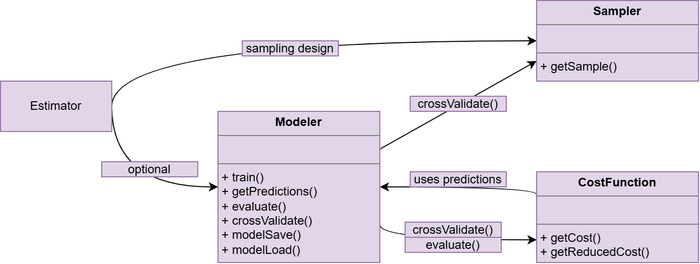

```{r setup, include=FALSE}
knitr::opts_chunk$set(echo = TRUE)
dir.create(file.path("./trained_modelers"), showWarnings = FALSE)
```

## ¿Qué es RMLUtils?

Es una herramienta para el desarrollo de procesos con machine learning en estadística oficial.

**Su idea no es sustituir todo el proceso, solo lo relacionado con la inferencia poblacional y predicción con modelos (aprendizaje supervisado).**

Idealmente debería complementarse con un análisis exploratorio de datos y un preprocesado apropiado para cada caso.

La principal ventaja de las librerías de MLUtils es que unifican múltiples librerías junto a implementaciones propias con una sintaxis común. Por ello, el usuario no debe aprender cómo funciona cada una de ellas. Sabiendo cómo funciona MLUtils, puede emplearlas todas.

## Arquitectura de clases de RMLUtils



Tenemos cuatro objetos principales en la librería:

* Sampler: Puede utilizarse tanto para definir diseños muestrales como para separar los datos en conjuntos (como train, test y validación).

* Modeler: Es un contenedor de modelos (de aprendizaje supervisado) con utilidades para entrenarlos, evaluarlos y guardarlos. Su sintaxis es común, incluso si usa librerías distintas.

* CostFunction: Definen métricas para evaluar los modelos entrenados y para el proceso de validación cruzada.

* Estimator: A partir de diseños muestrales y su consecuente muestra, permiten obtener estimaciones de características como el total poblacional de una o varias variables de interés. Se incluye el cálculo de varianzas en la salida.

## Instalación de RMLutils

La librería está disponible en el github del INE: \url{https://github.com/es-ine/rmlutils}

Para instalarse, primero debe instalarse el paquete `remotes`:

```{r}
#install.packages("remotes")
```

Tras ello, ejecutamos el comando (indicando luego la opción 1):

```{r}
#remotes::install_github("es-ine/rmlutils")
```

Y comprobamos que se ha instalado

```{r}
library(RMLutils)
#También activamos la librería de data.table, que se debería haber instalado junto a RMLutils
library(data.table)
```

Todos los objetos de RMLutils están documentados con ejemplos de uso, tanto en la documentación interna como en los tutoriales.

```{r}
#RMLutils::
```

Además, los objetos documentados están enlazados a otros que estén relacionados y a páginas "paraguas".

## Dependencias externas

RMLutils tan solo necesita `data.table` y `zip` para funcionar, pero para utilizar la mayoría de modelers, tendremos que instalar las librerías que sean necesarias:

1) Modelers simples:

  * `lightgbm`
  * `ranger`
  * `h2o`
  * `catboost`
  * `mice`

2) BenchModeler:

  * `osqp`
  * `gsubfn`
  * `Matrix`

Para estos tutoriales emplearemos sobre todo los modelos de ranger (random forest). Instalamos la librería:

```{r}
#install.packages("ranger")
```

RMLutils tiene algunas funciones para generar datos sintéticos, las utilizaremos para todas las pruebas que realicemos.
Para tratar con los datos, emplearemos `data.table`.

## Introducción a samplers

Nos permiten definir diseños muestrales para obtener estimadores, separar en train y test o aplicar validación cruzada con el método `crossValidate`.

```{r}
#RMLutils::sampler
```

Actualmente existen los siguientes tipos:

* `srsSampler`
* `ssSampler`
* `bootstrapSampler`
* `fullSampler`
* `cvSampler`
* `cvGroupSampler`
* `cvMixedSampler`
* `cvTemporalSampler`

Todos ellos tienen un método asociado llamado `get_sample()`.

Veamos un ejemplo con `srsSampler()`:

```{r}
#Generamos un conjunto de datos
data.dt <- generateRegressionData(100)
head(data.dt)

#Definimos un sampler y extraemos una muestra
sampler <- srsSampler(key = 1:nrow(data.dt), ssize = 3)
muestra <- getSample(sampler)
muestra

#Podemos extraer varias (se organizan en columnas)
muestra <- getSample(sampler, times = 4)
muestra

#Para indexar los datos y quedarnos con la muestra, seleccionamos la columna que queramos
muestra[, 2]
data.dt[muestra[, 2]]
```

Ahora separaremos los datos en un conjunto de entrenamiento y otro de test

```{r}
data.keys <- 1:nrow(data.dt)
sampler <- srsSampler(key = data.keys, ssize = 80)
train.keys <- getSample(sampler)
test.keys <- setdiff(data.keys, train.keys)

#Luego basta con indexar los datos, aunque por lo general no es necesario separar el conjunto físicamente en dos
#Veremos más adelante que RMLutils permite filtrar los datos según las claves que le pasemos
train.dt <- data.dt[train.keys]
test.dt <- data.dt[test.keys]
```

## Pipeline de entrenamiento y evaluación de modelers

### Regresión

```{r}
#Generamos y vemos los datos
data.dt <- generateStratifiedDomainModelAssistedEstimateData(n_samples = 10000)
data.dt[, strata_class := factor(strata_class, levels = c("Urban", "Rural"))]
data.dt[, domain_class := factor(domain_class, levels = c("Province_1", "Province_2", "Province_3"))]
head(data.dt)

#Exploramos los datos
data.dt[, .(income_medio = mean(income), income_sd = sd(income)), by = c("strata_class")]
data.dt[, .(cof_medio = mean(cost_of_living), cof_sd = sd(cost_of_living)), by = c("domain_class")]

hist(data.dt[, cost_of_living])
hist(data.dt[, income])

#Comportamiento de target según estrato y dominio
data.dt[, .(target_medio = mean(target), target_sd = sd(target)), by = c("strata_class")]
data.dt[, .(target_medio = mean(target), target_sd = sd(target)), by = c("domain_class")]

#Vemos la distribución de los estratos según el dominio
table(data.dt[, c("strata_class", "domain_class")])

summary(data.dt)
```

#### Separamos en train y test

Por simplicidad, vamos a aplicar muestreo aleatorio simple para separar entre train y test, aunque podríamos utilizar otros samplers para ello.

```{r}
set.seed(273)
data.keys <- 1:nrow(data.dt)
train_size <- round(0.7*nrow(data.dt))
sampler <- srsSampler(key = data.keys, ssize = train_size)
train.keys <- getSample(sampler)
test.keys <- setdiff(data.keys, train.keys)
```

#### Cómo definir un modeler

Podemos ver todos los modelos de regresión que hay usando el buscador y buscando `regressorModeler`.

```{r}
target <- "target"
regressors <- setdiff(colnames(data.dt), target)
params <- list(
                "num.trees" = 20,
                "max.depth" = 5
              )
modeler <- rangerRegressorModeler(params, target, regressors)
```

Podríamos entrenarlo directamente, pero lo ideal es escoger sus hiperparámetros antes.

#### Validación cruzada

Empleamos la función implementada de expansión de hiperparámetros de RMLutils

```{r}
hyperParamsSet <- list(
  "mtry" = c(2,3),
  "num.trees" = c(10, 20),
  "max.depth" = c(5, 10),
  "importance" = "impurity"
)
hyperParamsList <- expandHyperParams(hyperParamsSet)
```

Y luego definimos un bucle de validación cruzada, que obtenga el rendimiento del modelo para cada combinación de hiperparámetros.

En este bucle de validación, pretendemos obtener los hiperparámetros que optimicen una función de coste.
Podemos ver las que hay en el buscador introduciendo `costFunction`.

```{r}
#Definimos una función de coste
cf <- r2CostFunction()
opt_cost <- 0
n <- length(hyperParamsList)
for(i in 1:n){
  #print(i/n * 100)
  ranger_reg_modeler <- rangerRegressorModeler(params = hyperParamsList[[i]],
                                               target = target,
                                               regressors = regressors)
  #Aplicamos validación cruzada sobre el conjunto de entrenamiento
  #Es necesario proporcionar un sampler que permite obtener los conjuntos de train y validación
  cost <- crossValidate(modeler = ranger_reg_modeler,
                        data = data.dt,
                        CVSampler = cvSampler(key = train.keys, folds = 5),
                        costFunction = cf)
  
  if(cost[[1]] > opt_cost){
    opt_cost <- cost[[1]]
    opt_hyperparams <- hyperParamsList[[i]]
  }
}
print(opt_cost)
print(opt_hyperparams)
```

#### Entrenamiento y evaluación

Entrenamos con todo el conjunto de entrenamiento y los hiperparámetros óptimos.

```{r}
modeler <- rangerRegressorModeler(params = opt_hyperparams, target = target, regressors = regressors)
modeler <- train(modeler, data = data.dt, subSet = train.keys)
#Alternativamente
#modeler <- train(modeler, data = data.dt[train.keys])
```

Paralelamente a ranger, vamos a entrenar un modeler sencillo que calcule la media sobre cada combinación de estrato y dominio.

```{r}
modeler_simple <- strataMeanRegressorModeler(target = "target", regressors = c("strata_class", "domain_class"))
modeler_simple <- train(modeler_simple, data = data.dt, subSet = train.keys)
```

Vamos a evaluar los modelos empleando los métodos `evaluate()`, ya que son más cómodos de utilizar que con las funciones de coste directamente.

```{r}
#Test
evaluate(modeler, data = data.dt, subSet = test.keys, cost_function = MSECostFunction())
evaluate(modeler_simple, data = data.dt, subSet = test.keys, cost_function = MSECostFunction())
#Train
evaluate(modeler, data = data.dt, subSet = train.keys, cost_function = MSECostFunction())
evaluate(modeler_simple, data = data.dt, subSet = train.keys, cost_function = MSECostFunction())

#Comparamos el R^2 en train y test
evaluate(modeler, data = data.dt, subSet = test.keys, cost_function = r2CostFunction())
evaluate(modeler, data = data.dt, subSet = train.keys, cost_function = r2CostFunction())
```

#### Predicción

```{r}
ranger_preds <- getPredictions(modeler, data = data.dt, subSet = test.keys[1:10])
strata_mean_preds <- getPredictions(modeler_simple, data = data.dt, subSet = test.keys[1:10])
real_values <- data.dt[test.keys[1:10], target]
#Comparamos visualmente
cbind(real_values, ranger_preds, strata_mean_preds)
```

#### Guardado y carga

```{r}
#Guardado
modelSave(modeler, path = "./trained_modelers", fileName = "reg_modeler.mlu")
#Carga (importante añadir la extensión .mlu)
loaded_modeler <- modelLoad(path = "./trained_modelers", fileName = "reg_modeler.mlu")

getPredictions(loaded_modeler, data = data.dt, subSet = test.keys[1:10])
```

### Clasificación

Los modelers de clasificación tienen un funcionamiento prácticamente equivalente a los de regresión.
Podemos ver todos los que hay buscando `classifierModeler` en el buscador.

Para este nos saltaremos la validación cruzada y entrenamos directamente. El modelo tendrá que predecir el estrato en este caso.

```{r}
target <- "strata_class"
regressors <- setdiff(colnames(data.dt), target)
params <- list(
                "num.trees" = 10,
                "max.depth" = 5
              )
modeler <- rangerClassifierModeler(params, target, regressors)
modeler <- train(modeler, data = data.dt, subSet = train.keys)
```

Para la evaluación (o validación cruzada) hay que emplear funciones de coste de clasificación. Podemos verlas poniendo `costFunction` en el buscador.

```{r}
evaluate(modeler, data = data.dt, cost_function = accuracyCostFunction(), subSet = train.keys)
evaluate(modeler, data = data.dt, cost_function = accuracyCostFunction(), subSet = test.keys)
```

```{r}
#Podemos extraer información directamente de getCost, sin usar evaluate
cf <- ROCAUCCostFunction()
cost <- getCost(object = cf, data = data.dt, modeler = modeler, cSample = test.keys)
plot(cost$strata_class$class_metrics$fpr, cost$strata_class$class_metrics$tpr, type = "l")
```

#### getPredictions vs getClasses

El método `getPredictions` devuelve las probabilidades de selección de cada clase. Para obtener las clases predichas, hay que utilizar el método `getClasses`.

Este permite especificar el método de selección de la clase. Actualmente hay dos implementados:

* `maxScoreClass()`: Devuelve la clase con mayor puntuación. (predeterminado)
* `binaryThresholdClass()`: Para variables binarias, devuelve la clase positiva si su puntuación supera un cierto umbral especificado por el usuario.

```{r}
set.seed(273)
pred_sample <- sample(test.keys, size = 10)
getPredictions(modeler, data = data.dt, subSet = pred_sample)
getClasses(modeler, data = data.dt, subSet = pred_sample)
```

```{r}
cmapping <- binaryThresholdClass(threshold = 0.99, positive_class = "Urban")
getClasses(modeler, data = data.dt, subSet = pred_sample, class_mapping = cmapping)
```

## Introducción a estimadores

En RMLutils, las funciones estimadoras permiten obtener la estimación del total poblacional y la varianza de la estimación para un conjunto de datos y un diseño muestral dado. Introduciendo `estimator` en el buscador podemos ver todos los tipos que hay, aunque en este tutorial nos centraremos en dos de ellos (y sus versiones por dominios).

### Estimador HT

Muestreo aleatorio simple:

```{r}
data.dt <- generateEstimateData(n_samples = 10000)
head(data.dt)

set.seed(273)
key <- 1:nrow(data.dt)
srsmplr <- srsSampler(key = key, ssize = 800)#Muestra del 8% de la población
sample_1 <- getSample(srsmplr)

estim1 <- HTEstimate(object = srsmplr,
                     sampleKeys = sample_1,
                     sampleData = data.dt[sample_1])

estim1
sqrt(estim1$variance)
#Total real
sapply(colnames(data.dt), function(n){
  return(sum(data.dt[, ..n]))
})
```

Muestreo estratificado:

```{r}
data.dt <- generateStratifiedEstimateData(n_samples = 10000)
head(data.dt)

table(data.dt[, strata_class])
#Asig. proporcional al tamaño del estrato
#n_h = n * N_h/N

set.seed(273)
key <- 1:nrow(data.dt)
sssmplr <- ssSampler(key = key,
                     strata = data.dt[, strata_class],
                     ssize = c("Class_1" = 400,
                               "Class_2" = 240,
                               "Class_3" = 160)
                     )#Muestra del 8% de la población
sample_1 <- getSample(sssmplr)
target_cols <- c("Target_1", "Target_2", "Target_3")
estim1 <- HTEstimate(object = sssmplr,
                     sampleKeys = sample_1,
                     sampleData = data.dt[sample_1, ..target_cols])

estim1
sqrt(estim1$variance)
#Total real
sapply(target_cols, function(n){
  return(sum(data.dt[, ..n]))
})
```

¿Cómo se haría para una muestra real?

En ese caso los datos que tenemos son la muestra, no la población, con lo que tenemos que definir un objeto sampler que tenga las mismas características del muestreo que hayamos aplicado para obtener la muestra.

```{r}
#Asumiremos en este ejemplo ilustrativo que la población tiene 1000000 de individuos
muestra.dt <- generateEstimateData(n_samples = 5000)#Muestra de 0.5% de la población

#Definimos un sampler acorde al muestreo que hemos realizado
smplr <- srsSampler(key = 1:1000000, ssize = 5000)

#Las claves de la muestra son arbitrarias. Escogemos que vayan del 1 al 5000.
sample_1 <- 1:5000

estim1 <- HTEstimate(object = smplr,
                     sampleKeys = sample_1,
                     sampleData = muestra.dt)

estim1
sqrt(estim1$variance)

#Sabemos la distribución real:
#Target_1 ~ N(10,2)
#Target_2 ~ N(-20, 10)
#Target_3 ~ N(0,5)
c("Target_1" = 10 * 1000000,
  "Target_2" = -20 * 1000000,
  "Target_3" = 0)
```

Para diseños muestrales más complejos, sería necesario implementarlos. Tanto como sampler como para la función del estimador. Esta es una de las limitaciones de RMLutils que su versión en python soluciona, ya que los estimadores en esta última funcionan directamente para cualquier sampler que se implemente.

### Estimador HT por dominios

```{r}
data.dt <- generateStratifiedDomainModelAssistedEstimateData(n_samples = 10000)
head(data.dt)

#Calculamos solamente para muestreo aleatorio simple
set.seed(273)
key <- 1:nrow(data.dt)
srsmplr <- srsSampler(key = key, ssize = 800)#Muestra del 8%
sample_1 <- getSample(srsmplr)
sample_data.dt <- data.dt[sample_1]
domains <- sample_data.dt[, domain_class]#Solo se necesitan los dominios de la muestra
target_cols <- c("income", "cost_of_living")

#Calculamos el estimador
estim <- HTDomainEstimate(object = srsmplr,
                          sampleKeys = sample_1,
                          sampleData = sample_data.dt[, ..target_cols],
                          domains = domains)
estim
sqrt(estim$variance)

#Total real por dominio
data.dt[, .(total_income = sum(income), total_cof = sum(cost_of_living)), by = c("domain_class")]
```

### Estimador de Submuestreo Monte Carlo Rao-Blackwelizado

Este es un estimador insesgado asistido por modelos, diseñado y explicado en el paper de Sanguiao-Zhang (2020) Design-unbiased statistical learning in survey sampling \url{https://arxiv.org/abs/2003.11423}.

Asumamos un marco poblacional de 100000 de individuos, de los cuales tenemos algunas características conocidas. De este marco, extraemos una muestra de 5000 (5%), de la cuál sí conocemos la variable objetivo.
Nuestro objetivo es obtener el total poblacional de la variable target con un procedimiento de estimación asistida por modelos.

```{r}
#Población completa
N <- 100000
n <- 5000
poblacion.dt <- generateStratifiedDomainModelAssistedEstimateData(n_samples = N)
total_real <- poblacion.dt[, sum(target)]
varianza_real <- poblacion.dt[, var(target)]

#Definimos un diseño muestral aleatorio simple. Este simulará la muestra que extraemos
set.seed(273)
main_sampler <- srsSampler(key = 1:N, ssize = n)
main_sample <- sort(getSample(main_sampler))

#Ya que desconocemos la variable target fuera de la muestra, le asignamos NA
poblacion.dt[!main_sample, target := NA]

#Definimos un sub-sampler, que será el encargado de obtener las submuestras Monte Carlo
#sobre la muestra real que hemos extraído
#Especificamos que la submuestra sea del 70% del tamaño de la muestra principal (valor arbitrario)
sub_sampler <- srsSampler(key = main_sample, ssize = round(0.7*n))

#Definimos el modeler que será entrenado para efectuar la predicción
target <- "target"
regressors <- setdiff(names(poblacion.dt), target)
params <- list(
  "mtry" = 3,
  "num.trees" = 50,
  "max.depth" = 20
)
modeler <- rangerRegressorModeler(params, target, regressors)

#Llamamos al estimador Monte Carlo. Especificamos 50 submuestreos
estim <- MCSubRBEstimate(auxModeler = modeler,
                         data = poblacion.dt,
                         mainSampler = main_sampler,
                         subSampler = sub_sampler,
                         targetVar = target,
                         ssNumber = 50)
  
  

print("Valores reales:")
print(paste0("Total real: ", total_real))

print("Valores estimados:")
print(paste0("Total estimado: ", estim$total$value))
print(paste0("Error Monte Carlo del total estimado: ", estim$total$MC_error))
print(paste0("Varianza del estimador: ", estim$variance$value))
print(paste0("Error Monte Carlo de la varianza del estimador: ", estim$variance$MC_error))
```

### Estimador MC Sub-RB por dominios

El procedimiento es equivalente al anterior caso, pero en este caso se especifican los dominios en la función estimadora.

```{r}
#Población completa
N <- 100000
n <- 5000
poblacion.dt <- generateStratifiedDomainModelAssistedEstimateData(n_samples = N)
total_real <- poblacion.dt[, .(totales_por_dominio = sum(target)), by = c("domain_class")]
varianza_real <- poblacion.dt[, .(varianzas_por_dominio = var(target)), by = c("domain_class")]

#Definimos un diseño muestral aleatorio simple. Este simulará la muestra que extraemos
set.seed(273)
main_sampler <- srsSampler(key = 1:N, ssize = n)
main_sample <- sort(getSample(main_sampler))

#Ya que desconocemos la variable target fuera de la muestra, le asignamos NA
poblacion.dt[!main_sample, target := NA]

#Definimos un sub-sampler, que será el encargado de obtener las submuestras Monte Carlo
#sobre la muestra real que hemos extraído
#Especificamos que la submuestra sea del 70% del tamaño de la muestra principal (valor arbitrario)
sub_sampler <- srsSampler(key = main_sample, ssize = round(0.7*n))

#Definimos el modeler que será entrenado para efectuar la predicción
target <- "target"
regressors <- setdiff(names(poblacion.dt), target)
params <- list(
  "mtry" = 3,
  "num.trees" = 50,
  "max.depth" = 20
)
modeler <- rangerRegressorModeler(params, target, regressors)

#Llamamos al estimador Monte Carlo. Especificamos 50 submuestreos
estim <- MCSubRBDomainEstimate(auxModeler = modeler,
                               data = poblacion.dt,
                               mainSampler = main_sampler,
                               subSampler = sub_sampler,
                               targetVar = target,
                               domains = poblacion.dt[, domain_class],
                               ssNumber = 50)
  
  
total_estimado <- data.table("Dominios" = c(total_real[, domain_class]),
                             "total_estimado" = estim$total$value)
error_monte_carlo <- data.table("Dominios" = c(total_real[, domain_class]),
                                "error_MC_estimado" = estim$total$MC_error)
varianza_estimada <- data.table("Dominios" = c(total_real[, domain_class]),
                                "varianza_estimada" = estim$variance$value)
error_monte_carlo_varianza <- data.table("Dominios" = c(total_real[, domain_class]),
                                "error_MC_estimado_varianza" = estim$variance$MC_error)

print("Valor real:")
print(total_real)

print("Valores estimados:")
print(total_estimado)
print(error_monte_carlo)
print(varianza_estimada)
print(error_monte_carlo_varianza)
```

